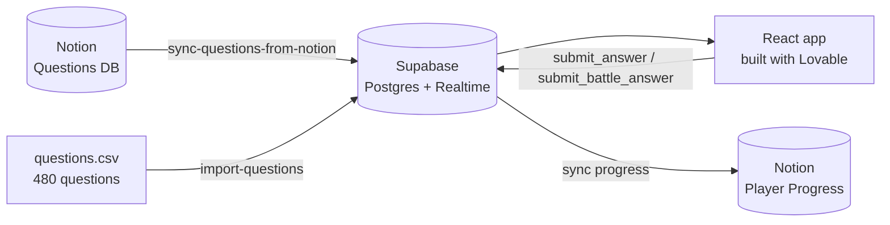

<!--
README for the Lovable app's own GitHub repo (the one Lovable creates), which is probably the repo you submit.
Copy this over that repo's README.md, fill every [bracket], delete this comment.
Don't add anything you can't point at: no made-up user counts. If the lunch playtest didn't happen, delete that line.
-->

# Career Quest

Find a cyber security career that fits you, then learn it in five-minute lessons.

Built in one afternoon at the Notion × Dublin AI Week Student Hackathon (TU Dublin Grangegorman, 9 October 2026)
for the challenge *"How can we use AI and technology to improve student life?"*

**Live app:** [Lovable URL] · **Demo video (60s):** [link] · **Notion HQ:** [link]

 <!-- add one screenshot of the lesson screen with Byte -->

## What it does

1. **Vibe Check.** An 8-question personality quiz matches you to one of 12 cyber careers, from SOC analyst to AI security.
2. **Meet the Jobs.** A quick quiz on what each job does all day.
3. **Lessons.** Duolingo-style units for your career with XP, streaks, hearts, and a boss round that unlocks a certificate.
4. **Live Battle.** A class or society plays the same questions together, Kahoot-style: one host screen, everyone else joins on their phone with a PIN.
5. **Notion.** Questions are written and edited in a Notion database and synced into the app. Your progress, weakest topic and a study plan sync back to Notion.

Every one of the 480 questions cites the standard it comes from: OWASP Top 10 for LLMs 2025, NIST CSF 2.0,
NIST SP 800-53 / 800-30 / 800-115, NIST AI RMF, MITRE ATT&CK or CIS Controls. Tap the source chip on any question to see it.

## How it works

- **Front end:** React + Vite + Tailwind, built with Lovable. Mascot animation with framer-motion.
- **Back end:** Supabase (Postgres, Auth, Realtime for Live Battle, Edge Functions for Notion and imports).
- **Content:** a Notion database plus a CSV import, both written server-side.

## Security

We're a cyber security team, so we attacked our own app. In a default build, the questions table is readable from
the browser, so anyone in a Live Battle could open dev tools and read every answer. We fixed that:

- Correct answers live in a table the browser can't read. Postgres functions mark every answer and award the XP.
- In Live Battle the server runs the clock. It rejects late and duplicate answers, works out the points, and only
  reveals the correct tile after the round ends.
- Imports and the Notion sync run in Edge Functions, limited to admin accounts.
- `/admin/security` runs these checks live against the anon client.

## Byte and the sound

**Byte**, the mascot, is a hooded insomniac bird drawn as one animated SVG component with 15 moods and lip sync.
No image files. The 18 sound effects are generated in the browser with the Web Audio API. No audio files either.

## AI use

We used Lovable to build the app from our own prompts, and AI tools to help draft the question bank and check it
against its cited sources. The idea, the mascot design, the prompts and the curation are ours.
Prepared before the day (allowed by the event rules): the idea, the mascot, the prompts and the question bank.
The app itself was built at the event.

## Team

- **[Euan Smith]**: [role]
- **Rhys Garbutt**: the 480-question bank, sourced and cited
- **[name]**: [role]

## Run it yourself

1. Fork this repo, create a Supabase project and run the migrations in `supabase/migrations`.
2. Add the secrets `NOTION_TOKEN`, `NOTION_DATABASE_ID`, `NOTION_QUESTIONS_DB_ID` and `ADMIN_EMAILS`.
3. `npm install && npm run dev`, then sign in with an admin email and press **Sync from Notion** or import `questions.csv` at `/admin/import`.
